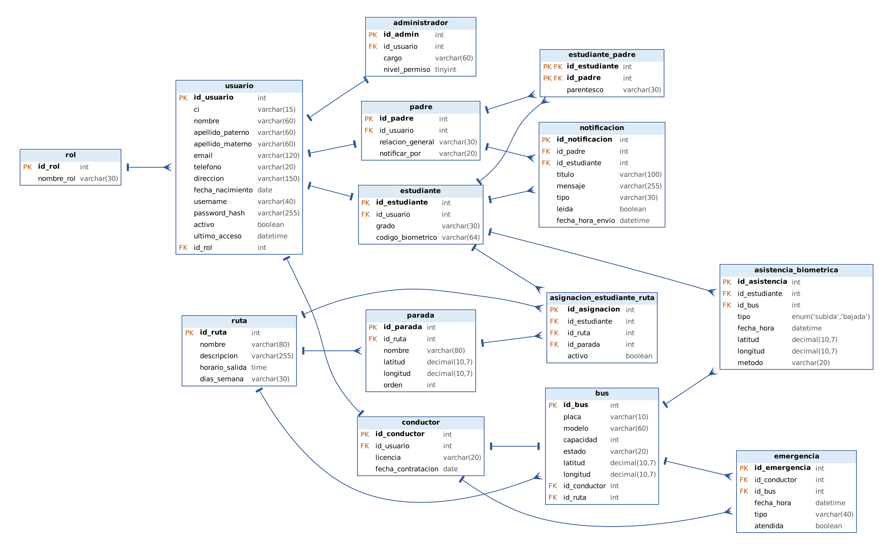

# Modelo relacional – Sistema de control del transporte escolar

Este documento convierte el diagrama de clases de bajo nivel (Tarea 2) en un modelo relacional para MySQL.



## Reglas de conversión aplicadas

| Elemento del diagrama de clases | Cómo quedó en el modelo relacional |
|---|---|
| Cada clase | Una tabla, con su `id` como clave primaria (PK) autoincremental |
| Herencia `Usuario` → `Administrador`, `Padre`, `Conductor`, `Estudiante` | Una tabla por subclase con `id_usuario` como clave foránea (FK) **única** (relación 1:1 con `usuario`) |
| Asociación 1 a muchos (`Rol` 1 — * `Usuario`, `Ruta` 1 — * `Parada`, etc.) | FK en la tabla del lado «muchos» |
| Asociación 1 a 1 (`Conductor` 1 — 1 `Bus`) | FK `id_conductor` **única** en `bus` |
| Clase asociativa `EstudiantePadre` (muchos a muchos con `parentesco`) | Tabla intermedia con PK compuesta `(id_estudiante, id_padre)` |
| Composición `Ruta` ◆— `Parada` | FK `id_ruta` con `ON DELETE CASCADE`: si se borra la ruta, se borran sus paradas |
| Agregación `Ruta` ◇— `Bus` | FK `id_ruta` en `bus` con `ON DELETE SET NULL`: el bus sigue existiendo sin ruta |
| Métodos (`iniciarSesion()`, `activarGPS()`, etc.) | No pasan a tablas: se implementan en el backend PHP |

## Tablas, atributos y claves

| Tabla | Clave primaria | Claves foráneas | Atributos principales |
|---|---|---|---|
| `rol` | `id_rol` | — | `nombre_rol` (único) |
| `usuario` | `id_usuario` | `id_rol` → `rol` | `ci`, `nombre`, `apellido_paterno`, `apellido_materno`, `email`, `telefono`, `direccion`, `fecha_nacimiento`, `username`, `password_hash`, `activo`, `ultimo_acceso` |
| `administrador` | `id_admin` | `id_usuario` → `usuario` (único) | `cargo`, `nivel_permiso` |
| `padre` | `id_padre` | `id_usuario` → `usuario` (único) | `relacion_general`, `notificar_por` |
| `conductor` | `id_conductor` | `id_usuario` → `usuario` (único) | `licencia`, `fecha_contratacion` |
| `estudiante` | `id_estudiante` | `id_usuario` → `usuario` (único) | `grado`, `codigo_biometrico` |
| `estudiante_padre` | `(id_estudiante, id_padre)` | `id_estudiante` → `estudiante`, `id_padre` → `padre` | `parentesco` |
| `ruta` | `id_ruta` | — | `nombre`, `descripcion`, `horario_salida`, `dias_semana` |
| `parada` | `id_parada` | `id_ruta` → `ruta` | `nombre`, `latitud`, `longitud`, `orden` (único por ruta) |
| `bus` | `id_bus` | `id_conductor` → `conductor` (único), `id_ruta` → `ruta` | `placa`, `modelo`, `capacidad`, `estado`, `latitud`, `longitud` |
| `asignacion_estudiante_ruta` | `id_asignacion` | `id_estudiante` → `estudiante`, `id_ruta` → `ruta`, `id_parada` → `parada` | `activo` |
| `asistencia_biometrica` | `id_asistencia` | `id_estudiante` → `estudiante`, `id_bus` → `bus` | `tipo` (SUBIDA/BAJADA), `fecha_hora`, `latitud`, `longitud`, `metodo` |
| `notificacion` | `id_notificacion` | `id_padre` → `padre`, `id_estudiante` → `estudiante` | `titulo`, `mensaje`, `tipo`, `leida`, `fecha_hora_envio` |
| `emergencia` | `id_emergencia` | `id_conductor` → `conductor`, `id_bus` → `bus` | `fecha_hora`, `tipo`, `atendida` |

## Decisiones de diseño

- **`id_parada` en `asignacion_estudiante_ruta`:** el diagrama une la asignación con `Parada`, así que cada estudiante queda asignado a la parada donde sube.
- **`id_estudiante` en `notificacion`:** se agregó como FK opcional para saber de qué hijo trata el aviso cuando un padre tiene más de un hijo en el bus.
- **`id_bus` en `emergencia`:** el diagrama relaciona `Emergencia` con `Bus` y con `Conductor`, por eso tiene las dos FK.
- **`tipo` en `asistencia_biometrica`:** es un `ENUM('SUBIDA','BAJADA')` para que no se guarden valores inválidos.

## Archivos SQL

- `database/01_schema.sql` – las 14 sentencias `CREATE TABLE`.
- `database/02_datos_prueba.sql` – datos ficticios para probar.
- `database/03_consultas.sql` – 4 consultas `SELECT` que responden preguntas reales del proyecto.

## Cómo probarlo

```bash
mysql -u root -p < database/01_schema.sql
mysql -u root -p < database/02_datos_prueba.sql
mysql -u root -p < database/03_consultas.sql
```
